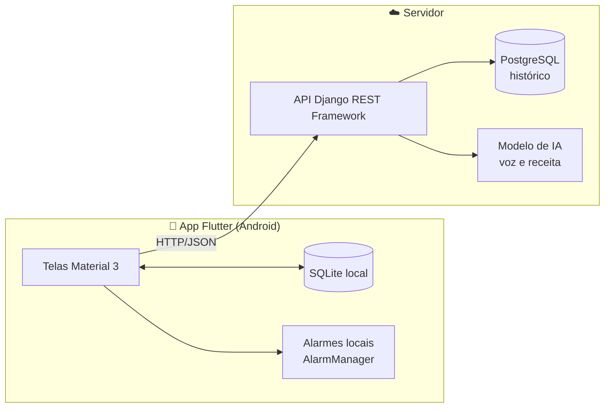

# MedCerto 💊

**Seus remédios, na hora certa.**
O app avisa, você confirma, e a família pode acompanhar de longe.

MedCerto é um aplicativo Android de lembrete de medicamentos feito para **pessoas idosas**. O foco é a usabilidade: letras grandes, botões grandes, uma ação por tela e confirmação de cada dose.

> Projeto acadêmico da disciplina de **Usabilidade (A3)**. Status: **protótipo funcional (alfa)**.

<!-- Coloque aqui um print das telas principais, ex.: docs/telas.png -->
<!--  -->

---

## 📌 O problema

Idosos costumam tomar vários remédios por dia, em horários diferentes. Esquecer uma dose, ou tomar duas vezes, é comum e pode trazer riscos à saúde. Os apps de lembrete que existem hoje costumam ter letras pequenas, muitas opções e cadastro complicado, o que afasta justamente quem mais precisa deles.

## 💡 A proposta

- **Cadastro fácil:** falar a receita, tirar uma foto dela ou digitar. A IA preenche os campos e a pessoa só confere.
- **Alarme confiável:** funciona sem internet e com o app fechado.
- **Confirmação da dose:** botões "Já tomei" e "+10 min". Se a pessoa não responder, chega um lembrete "Você já tomou?" 30 minutos depois.
- **Acompanhamento da família:** um familiar pode ver se as doses foram tomadas *(planejado)*.

---

## ✅ Funcionalidades

| Funcionalidade | Status |
|---|---|
| Entrada com PIN (criar, entrar, esqueci o PIN) | ✅ Pronto |
| Cadastrar, editar, pausar e remover remédio | ✅ Pronto |
| Horários por período (manhã/almoço/jantar) ou horário livre | ✅ Pronto |
| Todo dia ou dias específicos da semana | ✅ Pronto |
| Tela "Hoje" com status de cada dose (tomada, atrasada, agora) | ✅ Pronto |
| Alarme local agendado, repetindo sozinho, inclusive com o app fechado | ✅ Pronto (em teste nos aparelhos) |
| Botões **Já tomei** e **+10 min** na própria notificação | ✅ Pronto |
| Lembrete de acompanhamento ("Você já tomou?") | ✅ Pronto |
| Desfazer confirmação | ✅ Pronto |
| Histórico dos últimos 7 dias e % de adesão | ✅ Pronto |
| Aviso de remédio acabando (estoque da caixa) | ✅ Pronto |
| Tamanho da letra, alto contraste, vibração e som do alarme | ✅ Pronto |
| Cadastro por **voz** com IA | 🧪 Tela pronta, IA simulada |
| Cadastro por **foto da receita** com IA | 🧪 Tela pronta, IA simulada |
| Entrada por digital (biometria) | 🔜 Planejado |
| Acompanhamento da família (convite por e-mail) | 🔜 Planejado (depende do backend) |

---

## 🏗️ Arquitetura

O app segue a ideia de **local primeiro**: remédios, horários e doses ficam salvos no próprio celular, para que o alarme nunca dependa de internet. O servidor entra apenas para a leitura por IA e para a cópia do histórico que a família acompanha.



Sem internet, ou com o servidor fora do ar, o cadastro manual e os alarmes continuam funcionando.

---

## 🛠️ Tecnologias

- [Flutter](https://flutter.dev/) / Dart, com Material 3
- [`flutter_local_notifications`](https://pub.dev/packages/flutter_local_notifications) para os alarmes e notificações locais
- [`timezone`](https://pub.dev/packages/timezone) para o fuso horário dos alarmes
- [`sqflite`](https://pub.dev/packages/sqflite) para o banco de dados local
- Backend *(em desenvolvimento)*: Django REST Framework + PostgreSQL
- Design: Figma

---

## 🚀 Como rodar

**Pré-requisitos:** Flutter instalado (`flutter doctor` sem erros) e um celular Android ou um emulador.

```bash
git clone https://github.com/SEU-USUARIO/SEU-REPO.git
cd SEU-REPO
flutter pub get
flutter run
```

**Gerar o APK:**

```bash
flutter build apk --release
# arquivo em: build/app/outputs/flutter-apk/app-release.apk
```

### Primeiro uso

1. Toque em **Entrar com PIN** e crie um PIN de 4 números.
2. Permita as **notificações** quando o Android pedir.
3. Cadastre um remédio em **Adicionar → Digitar**.
4. Para conferir se o alarme funciona, vá em **Perfil → Testar alarme → Agendar daqui a 1 minuto** e depois bloqueie a tela.

> **Celulares Samsung:** em Configurações → Aplicativos → MedCerto → Bateria, escolha **"Sem restrições"**. Sem isso, a economia de bateria pode atrasar o alarme.

---

## 🧪 Testes

```bash
flutter test
```

São 23 testes unitários das regras de validação (nome, dose, horários, dias, estoque, PIN) e dos cálculos (dias restantes de remédio e percentual de adesão). Ficam em [`test/validacao_test.dart`](test/validacao_test.dart).

---

## 📁 Estrutura do projeto

```
lib/
├── main.dart                 # inicialização e tratamento das notificações
├── models/                   # Medicamento, RegistroDose, Preferencias
├── services/
│   ├── banco.dart            # SQLite
│   ├── notificacoes.dart     # agendamento dos alarmes
│   ├── acoes.dart            # "Já tomei", "+10 min", desfazer
│   └── estado.dart           # estado global simples
├── screens/                  # uma tela por arquivo (Início, PIN, Hoje, Remédios...)
├── widgets/                  # componentes reutilizáveis e barra inferior
├── theme/tema.dart           # cores e tema (design system)
└── utils/                    # validação e datas
test/
└── validacao_test.dart
```

---

## 🎯 Usabilidade: heurísticas de Nielsen aplicadas

| Heurística | Como aparece no app |
|---|---|
| 1. Visibilidade do status | Tela Hoje mostra cada dose como *tomada*, *atrasada* ou *agora*, mais as barras da semana |
| 2. Correspondência com o mundo real | Linguagem simples ("Já tomei", "Manhã", "Almoço", "Jantar") |
| 3. Controle e liberdade | "Desfazer" depois de confirmar, "+10 min", pausar lembretes |
| 4. Consistência e padrões | Material 3, mesma barra inferior e mesmas cores em todas as telas |
| 5. Prevenção de erros | Validação dos campos, confirmação antes de remover, a IA nunca salva sem conferência |
| 6. Reconhecimento em vez de memorização | Horários e status sempre visíveis |
| 7. Flexibilidade e eficiência | Três formas de cadastrar: falar, foto ou digitar |
| 8. Design minimalista | Uma ação principal por tela |
| 9. Recuperação de erros | Mensagens claras dizendo o que corrigir |
| 10. Ajuda e documentação | Textos de apoio nas telas e tela "Testar alarme" |

**Acessibilidade:** botões com 48 dp ou mais, contraste reforçado, tamanho de letra ajustável e rótulos para leitores de tela.

---

## 🗺️ Próximos passos

- [ ] Conectar o cadastro por voz e por foto à API de IA
- [ ] Backend Django com a réplica do histórico
- [ ] Acompanhamento da família
- [ ] Entrada por biometria
- [ ] Testes de usabilidade com idosos

---

## 👥 Equipe

Projeto desenvolvido por um grupo de 8 estudantes:

| Nome | Frente |
|---|---|
| Nome Sobrenome | Gestão / Front-end |
| Nome Sobrenome | Back-end |
| Nome Sobrenome | Back-end |
| Nome Sobrenome | Front-end |
| Nome Sobrenome | Front-end |
| Nome Sobrenome | Design / UX |
| Nome Sobrenome | Design / UX |
| Nome Sobrenome | Documentação |

📄 Documentação completa: [GitBook do projeto](COLE-O-LINK-AQUI)

---

<sub>Projeto acadêmico, sem fins comerciais. O MedCerto não substitui orientação médica.</sub>
